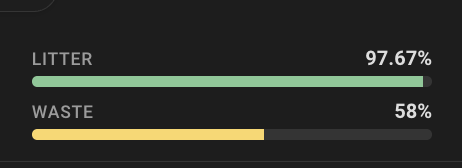
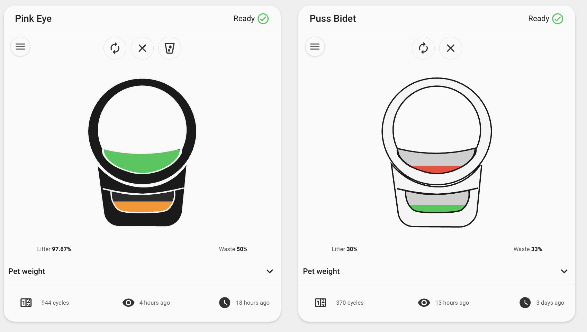
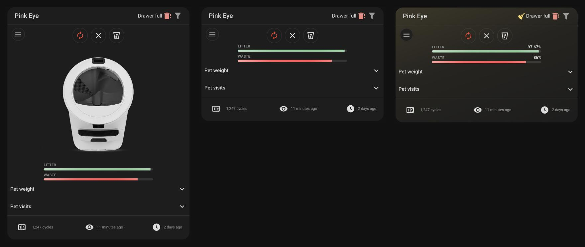

# Feature flags

## Gauge percentages

Show fill **percentages** on litter and waste gauge labels (and on the SVG level graphic when that feature is on):



```yaml
type: custom:whisker-card
device_id: YOUR_DEVICE_ID
features:
  - percentage
```

## Illustrated levels

Replace the marketing robot image and thin litter/waste bars with an opt-in illustration. Litter (globe bed) and waste (drawer panel) zones fill from the bottom in proportion to their level — a drawer at 90% draws nearly full — and color by level, green / yellow / red, while the rest of the robot stays neutral. Tap a zone to open that entity's more-info dialog.



```yaml
type: custom:whisker-card
device_id: YOUR_DEVICE_ID
features:
  - illustrated
  # optional:
  # - percentage
```

The illustration follows the `color` option, so it renders in black or white to match your artwork preference.

## Hide robot image

Drop the robot photo but keep everything else on the full card — status, quick actions, controls menu, gauges, pet graphs, and footer. Handy on an overview dashboard where the full card is too tall, while a dedicated page keeps the illustrated version.

Left to right: the default card, `hide_image`, and `hide_image` with gauge percentages and a [cleaning reminder](CLEANING-REMINDER.md) glowing.



```yaml
type: custom:whisker-card
device_id: YOUR_DEVICE_ID
features:
  - hide_image
```

How it differs from the [mini layout](OPTIONS.md#mini-layout): mini is a title row plus gauges only; `hide_image` keeps every section and removes just the picture.

With `illustrated` also on, the illustration stays — it _is_ the litter/waste gauge, not decoration — so `hide_image` has no effect there. The `color` option only tints the photo or illustration, so the visual editor hides it while `hide_image` is on without `illustrated`.

> Looking for pet weight? Add `pet_weight` to the [footer](FOOTER.md), or use the pet weight **graph** (history or statistics) configured via the `chonk` option. See [Pet weight graph](OPTIONS.md#pet-weight-graph).

> Looking for pet visits? That graph is configured via the `visits` option, not a feature flag. See [Pet visits graph](OPTIONS.md#pet-visits-graph).
